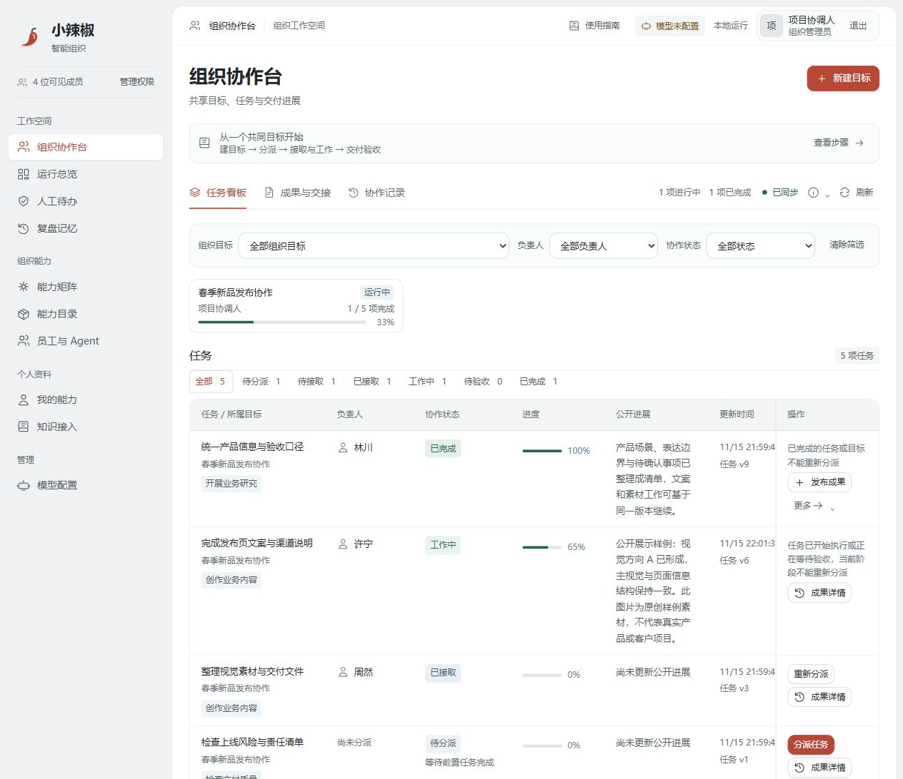
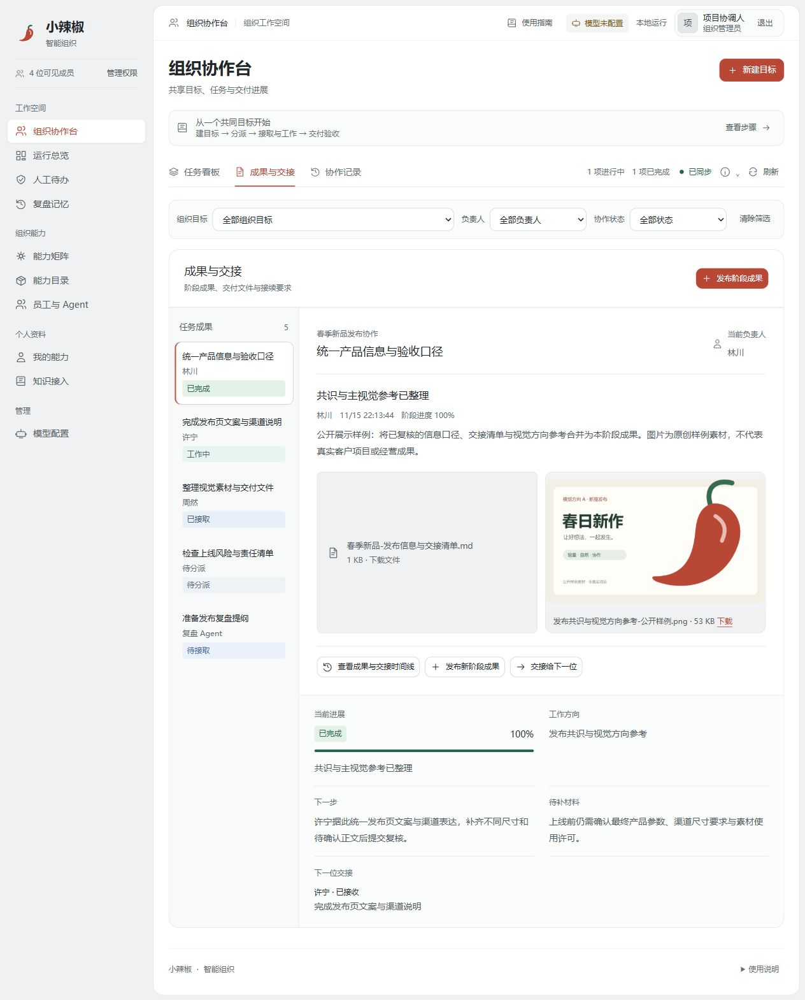

# Intelligent Organization

[简体中文](README.md)

[Use cases](#where-it-can-help) · [Workflow](#a-complete-workflow-in-six-steps) · [Capabilities](#make-human-and-agent-capabilities-understandable) · [Coordination costs](#the-coordination-costs-it-aims-to-reduce) · [Get started](#get-started) · [License](#license-and-participation) · [Support](#support-the-project)

**People and AI Agents contributing through their strengths, with connected goals, deliverables and handoffs.**

Intelligent Organization is a workspace for collaboration between people and AI. It breaks goals into tasks with named owners, defined inputs and outputs, and clear acceptance criteria. Specialists can focus on work they do well, while Agents handle suitable analysis, drafting and organization of information.

We want to explore a different way of working: one that relies less on instructions passed verbally through a hierarchy, and does not require everyone to sit in the same office for work to move forward. Each contributor should understand the shared goal, how their work connects to others, and the capabilities, results and responsibilities involved. **Teamwork without a fixed office is the vision; the current release establishes the collaboration workflow within a local workspace.**

“Intelligent” means more than connecting a model. It also means helping an organization understand who can do what, who owns the work, where it stands, what is missing, who will review it and who takes it next. A person's specific expertise can become a discoverable, verifiable and assignable capability, without relying on one colleague to remember everyone's experience.

> **Available today:** Windows x64 desktop and source editions, with multiple accounts in a workspace on one computer. The service listens only on `127.0.0.1`. Access from other computers, LAN collaboration and internet collaboration are not implemented.



*Fictional public examples in the Chinese interface, not actual project outcomes. Both language editions have the same functionality.*

<details>
<summary>View stage deliverables, evidence files and downstream handoffs</summary>



A result can contain more than a “done” message: stage notes, images, video, files, missing material and a next step. Handoff records identify the version passed on, its recipient and whether it was received. This screenshot also uses fictional public examples.

</details>

## From individual effort to a shared result

Work often has enough people and tools, but lacks a shared account of how it connects. Tasks sit in conversations and evidence sits in folders. An owner knows the background, while a contributor receives a one-line request. The upstream contributor believes the work is delivered, but the next person is still waiting for usable material. Adding more disconnected AI conversations does not resolve those problems.

Intelligent Organization keeps that information in the context of the work:

- **Shared goals:** describe why the work matters, the intended result and how completion will be judged.
- **Named responsibility:** assign a task to a specific member or Agent. Candidates remain visible even when qualifications are missing, and unmet execution requirements are explained.
- **Visible progress:** record acceptance, starting work, public updates, submission, review and return separately. Having an owner, being in progress and having an accepted result are different facts.
- **Deliverables that can be handed over:** pass stage results, evidence and next steps to the downstream contributor, rather than forwarding a completion message alone.
- **Experience that remains usable:** retain sources, problems and retrospective notes as traceable references for future work.

The workspace fits work that needs clear responsibilities, successive deliverables and a combination of human and Agent contributions. Start with one goal and a few contributors, then add capability records, material and processes as needed. The default workflow is a fixed five-step template; task dependencies can also be defined manually. The system does not automatically decide all organizational responsibilities or business rules.

## Where it can help

These are **examples of how to adapt the workspace, not preinstalled business templates or existing integrations**. Teams define their own tasks, capabilities, material and acceptance criteria. External actions such as publishing, purchasing and contacting customers still take place in the appropriate systems, performed by people.

| Scenario | How people and Agents can contribute | Possible handoff deliverables |
| --- | --- | --- |
| Content and brand marketing | Researchers supply sources; an Agent organizes points and drafts text; editors and brand owners check facts and expression. | Topic briefs, sourced copy, revision notes and a publication checklist. |
| Product or service launches | Product staff confirm information, marketing organizes material, and designers create visuals; an Agent helps consolidate messaging and checklists. | Confirmed product information, communication assets and review records. |
| Design and creative work | Requesters provide constraints, designers produce options, and reviewers give feedback; an Agent helps organize copy and review criteria. | Design notes, image or video versions, revision rationale and the selected option. |
| Software requirements and testing | Product, development and QA contributors own requirements, implementation and verification; an Agent drafts requirements or test-case text. | Acceptance criteria, implementation notes, defect evidence and test records. |
| Research and analysis | Researchers collect and verify sources; an Agent summarizes supplied material; specialists check conclusions and uncertainty. | Source lists, comparisons, open questions and research findings. |
| Events and ongoing operations | An operations owner divides preparation work among contributors; an Agent helps organize plans, explanations and retrospective drafts. | Execution checklists, stage updates, event records and lessons learned. |
| Customer information preparation | Staff select material they are authorized to use; an Agent helps summarize needs; an owner checks omissions and sensitive content. | Requirements summaries, questions, meeting preparation and follow-up actions. |
| Project and service delivery | Specialists own their stages, a project owner coordinates dependencies and review, and an Agent helps organize delivery notes. | Stage deliverables, review comments, unresolved items and inputs for the next phase. |
| Organizational knowledge | Experienced members provide methods and examples; an Agent helps organize them; a reviewer confirms scope and supporting sources. | Working methods, procedures, capability evidence and reusable references. |
| Training and course production | Experts supply content, curriculum staff structure it, and instructors and reviewers verify it; an Agent helps draft outlines and exercises. | Course outlines, lesson material, examples and review feedback. |
| Administration and procurement material | Requesters specify needs and members collect quotations and documents; an Agent drafts comparisons for a human decision-maker. | Requirements, quotation material, comparison criteria and pending decisions. |
| Cross-functional initiatives | Contributors from different roles work toward a shared result, an owner coordinates prerequisites, and an Agent helps summarize progress. | Responsibility records, dependencies, stage results and next-step ownership. |

The same working method can support different contexts, but does not replace professional judgment. Designers still create assets in design tools, software verification still requires actual testing, and procurement and payments still follow the relevant decision process. The workspace connects responsibilities, progress and evidence around that work.

## A complete workflow in six steps

| Step | What to do | What remains on record |
| --- | --- | --- |
| **1. Define the goal** | Describe context, the intended result and acceptance criteria. Use the default workflow or define tasks and dependencies manually. | A goal and completion criteria that contributors can understand together. |
| **2. Assign responsibility** | Choose from the full member and Agent roster, checking capabilities, permissions, availability and prerequisites. | A named assignee and any requirements that still need to be met. |
| **3. Accept and work** | Members accept and start their own tasks. An owner initiates Agent execution from Run overview. | Acceptance, starting work and progress records, beyond assignment alone. |
| **4. Publish stage results** | Explain direction, stage, progress, results, missing material and next steps, and select attachments to share. | Public progress and evidence. Publishing an update does not itself complete the task. |
| **5. Submit and review** | Another authorized person reviews or returns an ordinary human-task submission. Include a human review node when Agent work needs human approval. | An explicit acceptance or reason for revision, with a record of changes. |
| **6. Hand off and learn** | Send a selected result from a completed upstream task to its downstream assignee, record acceptance or return, and capture lessons. | Traceable handoffs, remaining issues and retrospective material. |

<details>
<summary>A concrete example: preparing a new-employee onboarding pack</summary>

This is a fictional workflow example, not a preinstalled project.

1. **The owner defines the result.** The goal is to produce a role description, a first-week plan and an FAQ. Acceptance criteria require clear sources, consistent responsibilities and a separate list of points still needing confirmation.
2. **Assign work by expertise.** A person familiar with the role supplies original notes; a strong writer prepares the documents; an Agent organizes the supplied material into an outline; another responsible person checks the result.
3. **Start from shared context.** Members import the text they can use and accept their tasks. Material for the Agent must belong to the goal creator or have been imported as organization knowledge; other members’ private documents do not automatically enter its context. The Agent drafts from supplied material. Missing policy information is recorded as material still needed, for people to supply rather than for the model to invent.
4. **Leave evidence as work progresses.** Contributors publish stage notes, attach documents and relevant images, and state the next step. Others can understand progress without asking for the entire background again.
5. **Check before accepting.** Another authorized person reviews the ordinary human writing task after submission. Inadequate content is returned with a reason. An Agent's text is not evidence that a policy has been approved; it should proceed to the appropriate human review stage.
6. **Make the handoff explicit.** A completed document version is passed to the assignee of the downstream training task. The recipient confirms receipt or explains what is missing. Receiving the material neither starts the training task automatically nor means that training is complete. Omissions and improvements are then recorded in a retrospective.

</details>

## Clear standards for where work stands

Task status, public progress, deliverable review and handoff receipts describe different facts. A percentage alone cannot express all of them.

| Status or record | What it means |
| --- | --- |
| Unassigned | No assignee has been selected. The owner needs to choose a member or Agent. |
| Assigned / Accepted | A person has been assigned; acceptance confirms that the person has taken responsibility, but does not mean work has started. |
| In progress | Work has started. The assignee can update public progress and publish stage results. |
| Awaiting review | An ordinary human task has a submitted deliverable awaiting a decision by another authorized person. |
| Completed | The task has completed under its execution protocol. Completion of an Agent text node does not mean every result has been reviewed by a person. |
| Blocked, failed or requirements pending | A specific condition needs attention. An assigned task is not necessarily ready to execute. |
| Handoff pending / accepted / returned | A receipt for transferred material, separate from task assignment, starting work or deliverable review. |

Members can accept and act on tasks assigned to them. An owner can coordinate assignments, but cannot impersonate another member to accept a task or sign that member's human decision node. Ordinary human submissions cannot be reviewed by their submitter. A dedicated human decision node must also be handled by its assigned person.

A handoff connects **a completed upstream task, a specific result version and a direct downstream task assigned to a qualified member**. The recipient can confirm that the material is usable or return it with an explanation of what is missing. A handoff does not change the assignee or bypass other dependencies. Upstream rework, a new completed task artifact or downstream reassignment can make a pending handoff no longer receivable; the interface explains why. Accepted receipts remain in the history, and publishing another stage update alone does not invalidate the original handoff.

Shared state refreshes approximately every two seconds. A version conflict retains the input in the currently open form. After loading the new version, the user checks it before submitting again. During a connection loss, existing page content is retained rather than treating stale information as a new successful result.

## Make human and Agent capabilities understandable

**An atomic capability is a specific piece of work with a clear boundary and a result that can be checked.** “Prepare a customer requirements summary from supplied material and flag missing information” is easier to match to a task than broad labels such as “understands operations” or “uses AI.”

The capability catalog and matrix put people and Agents into the same view of the work, while preserving different kinds of evidence:

- **For people:** members can claim capabilities and levels, cite actual excerpts from local documents, and have those claims reviewed by an administrator. Self-reports, keyword suggestions, verified claims and rejected claims remain distinct. A self-assessed level is not certification.
- **For Agents:** records describe the capability, provider and execution mode. A declaration explains the work an Agent is intended to perform; it does not prove extensive testing or a working connection to external tools.
- **For execution permissions:** capability registration, human verification and authorization are separate. Confirming that someone can do a piece of work does not automatically grant every related permission.

A Skill describes a capability through its purpose, inputs, outputs, acceptance criteria, steps, limitations, declared tools and examples. Import Markdown / `SKILL.md` with flat frontmatter metadata, or JSON in the supported structure. Preview and complete the inputs, outputs, acceptance criteria and other required descriptions before registering it to a provider, with the source retained for reference.

Importing a Skill for a member creates a claim awaiting verification; importing one for an Agent registers a declaration. **Uploading a Skill does not install tools, execute scripts or grant permissions.** Capabilities need evidence from actual work, not just a polished description.

Assignment can select any account-linked member or registered Agent in the roster, even when requirements are incomplete. The interface explains missing capabilities, verification, permissions, availability, dependencies or model conditions. Responsibility can therefore be made clear without bypassing execution checks merely to make an assignment succeed.

## Knowledge, models and data

### Bring material into context

Import local Markdown, text files or pasted content. Each import is a **snapshot of the material at that time**, not an automatic synchronization with the original file. Personal and organization documents have separate access scopes. Capability claims can cite genuine excerpts from their sources.

Public deliverables and private knowledge are different things. Uploaded attachments are initially staged for their uploader; selected attachments become part of a public organizational update when published. Existing private material is not automatically made public. Authorized downstream assignees can receive completed prerequisite outputs as context, so contributors should consider the intended audience before publishing or submitting content.

### Choose the model you need

Administrators can configure a local model service or a compatible cloud API in Model settings, including the endpoint, model and credentials. A connection test sends fixed test text. Saving and activating the settings makes them the workspace configuration; a successful connection test is not validation of a real business task.

Human collaboration remains available without a configured model; Agent execution explicitly reports missing requirements. Current Agents primarily analyze, draft, check and summarize supplied text. They do not independently browse the web, execute arbitrary scripts, send messages or operate external business systems. Images and videos can be uploaded, previewed and downloaded as evidence, which does not imply automatic recognition, editing or generation.

With a cloud model, the material required for execution is sent to the configured service and may incur provider charges. The workspace's Agent budget counts **call attempts, including failed attempts**. It is not a spending limit or a token allowance.

### Local storage with explicit boundaries

Accounts, tasks, documents and attachments are stored on the computer hosting the workspace. Registration does not require an email address or cloud account, and passwords are stored as salted hashes. Personal documents, public organizational information and task deliverables each follow their own access rules. The data locations listed below can be used to plan backups.

## The coordination costs it aims to reduce

The workspace provides mechanisms to reduce repeated communication and scattered information. Results depend on task descriptions, record-keeping habits, material quality and team processes. Track task turnaround time, follow-up requests, time spent finding material and instances of rework to assess actual improvement.

| Cost | Common problem | Mechanism |
| --- | --- | --- |
| Passing information | Context is relayed through several people and important constraints are lost. | Goals, inputs and acceptance criteria remain with the task so contributors can consult the same context. |
| Aligning work | Everyone is busy, but people disagree about what completion means. | Define results, prerequisites and review responsibility before starting, and retain specific reasons for returns. |
| Finding contributors | Assignments depend on someone remembering who has the right experience. | Use the capability matrix, evidence and full roster to find assignees and see missing requirements. |
| Repeating explanations | Every change of contributor requires another account of the background. | Keep original instructions, stage records, results and next steps together. |
| Finding material | Files and conversations are scattered, and it is unclear which version belongs to a task. | Keep sources and published results in their work context, with handoffs pointing to a particular version. |
| Waiting and following up | People cannot tell whether work has been accepted, where it is stuck or who needs to supply information. | Distinguish assignment, acceptance, work, review and blockers, and record missing material publicly. |
| Rework | Problems emerge late and the reasons for changes are lost. | Stage results, explicit standards and independent review make problems and revision criteria visible earlier. |
| Handoffs | The upstream contributor believes work is delivered, while the recipient cannot use the material. | Specify the result, recipient and receipt; return incomplete material with a reason instead of assuming it was received. |
| Learning and drafting again | Experience stays in individual memory and the next task starts from scratch. | Retain work records and retrospectives, and let Agents help organize existing material so people can focus on judgment and improvement. |

These mechanisms do not eliminate discussion or replace management responsibility. They give necessary conversations a shared basis and reduce repeated relaying of information that can be recorded, consulted and reused.

## Boundaries and future direction

The current release is best suited to trying collaboration workflows locally, conducting small-scale task exercises and developing further from source. Complex work still needs team-defined rules and professional judgment. A task status is not proof of financial approval, a legal conclusion or an action completed in an external system.

Future directions include workspaces across devices, identity and access controls suitable for remote collaboration, deployment and backup tools, and more auditable capability and external-tool connections. Each needs appropriate permission, operational and security design. **These are directions, not delivered features or delivery-date commitments.**

The principle remains the same as the product expands: assign work to a named provider, make inputs and results explicit, preserve evidence and traceability, and leave important decisions with the people authorized to make them.

## Get started

The current desktop client is named **Xiaolajiao**, part of the Intelligent Organization project. Chinese and English editions have the same functionality.

**To use the workspace:** download the Windows x64 installer for your language. No separate Python or Node.js installation is required.

| Language | Windows x64 installer (recommended) | Complete source ZIP |
| --- | --- | --- |
| English | [Download English installer](https://github.com/lizhenjie137/intelligent-organization/releases/download/v0.1.0/Xiaolajiao-en-0.1.0-Windows-x64-Setup.exe) | [Download English source](https://github.com/lizhenjie137/intelligent-organization/releases/download/v0.1.0/xiaolajiao-en-source-2026-11-15.zip) |
| 简体中文 | [Download Chinese installer](https://github.com/lizhenjie137/intelligent-organization/releases/download/v0.1.0/Xiaolajiao-zh-0.1.0-Windows-x64-Setup.exe) | [Download Chinese source](https://github.com/lizhenjie137/intelligent-organization/releases/download/v0.1.0/xiaolajiao-zh-source-2026-11-15.zip) |

[View the v0.1.0 release notes and all assets](https://github.com/lizhenjie137/intelligent-organization/releases/tag/v0.1.0).

To inspect the implementation, make changes or develop further, download the complete source ZIP for your language. Running from source requires Windows, Python 3.11+ and PowerShell. Building the desktop application also requires Node.js 22.12+.

### Desktop installer

1. Run the Windows x64 installer for your language, complete installation and open Xiaolajiao.
2. Register with a display name, username and a password of at least 12 characters, then confirm the password. No email address is needed and there is no preset account.
3. The first account registered in an empty workspace becomes its administrator. Subsequent accounts are members; the server determines the role.
4. Create an organization goal, add capability records or material, assign tasks and begin collaborating. When Agents are needed, an administrator can configure and test the model.

### Source edition

Extract the source archive for your language and run from its root:

```powershell
.\Install.ps1
.\Start-Xiaolajiao.ps1
```

The browser address is `http://127.0.0.1:8769` for Chinese and `http://127.0.0.1:8771` for English. Register in the same way. If the port is occupied, the startup script stops with an explanation instead of treating an existing service as this workspace. Choose an unused port, for example:

```powershell
.\Start-Xiaolajiao.ps1 -Port 8783
```

Source data is stored in `data/workspace/` inside the package. Desktop data defaults to `%LOCALAPPDATA%\Xiaolajiao\zh\workspace` or `en\workspace`. **Desktop and source workspaces, and the two language editions, keep separate data with no automatic migration.** Include your workspace data in backups. Closing the desktop window stops its associated backend service.

## License and participation

Downloading, installing, using and modifying the application is permitted. **Selling the original application or derivative versions requires authorization.** This is a source-available license; see [LICENSE](LICENSE) and [LICENSING.md](LICENSING.md) for the governing terms. Third-party components retain their own licenses.

Feedback on real collaboration needs, workflow problems, documentation and reproducible defects is welcome. Include the version, steps, expected behavior and actual result; that is more useful for diagnosis than an error screenshot alone. Remove personal information, credentials and private workspace content before sharing. Changes involving permissions, external calls or data migration should explain their scope and how they were checked.

Created by **Zhiqihui AI · 执棋会AI**. Maintainer: [lizhenjie137](https://github.com/lizhenjie137).

## Support the project

<p align="center">
  <strong>WeChat Pay</strong><br><br>
  
</p>

<p align="center">感谢支持，开源不易<br>Thank you for supporting the project and its ongoing development.</p>

<p align="center"><a href="https://qr.alipay.com/tsx1311822nwtvpok989m8c">Support via Alipay</a></p>
