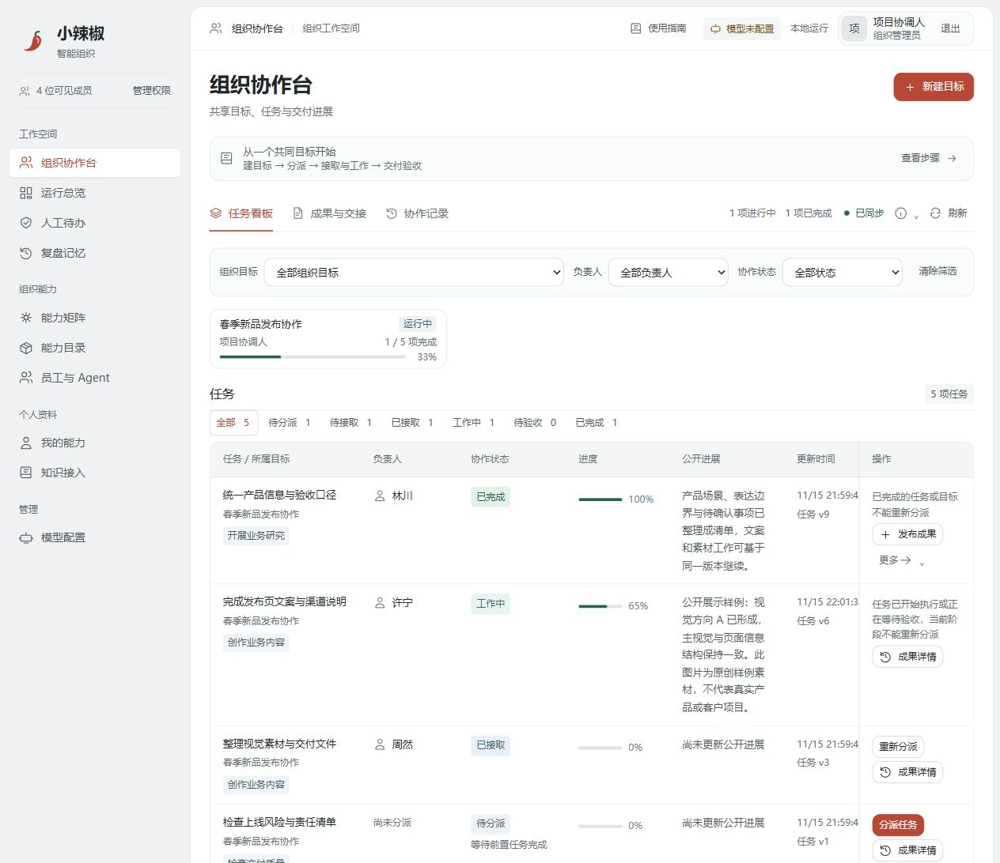
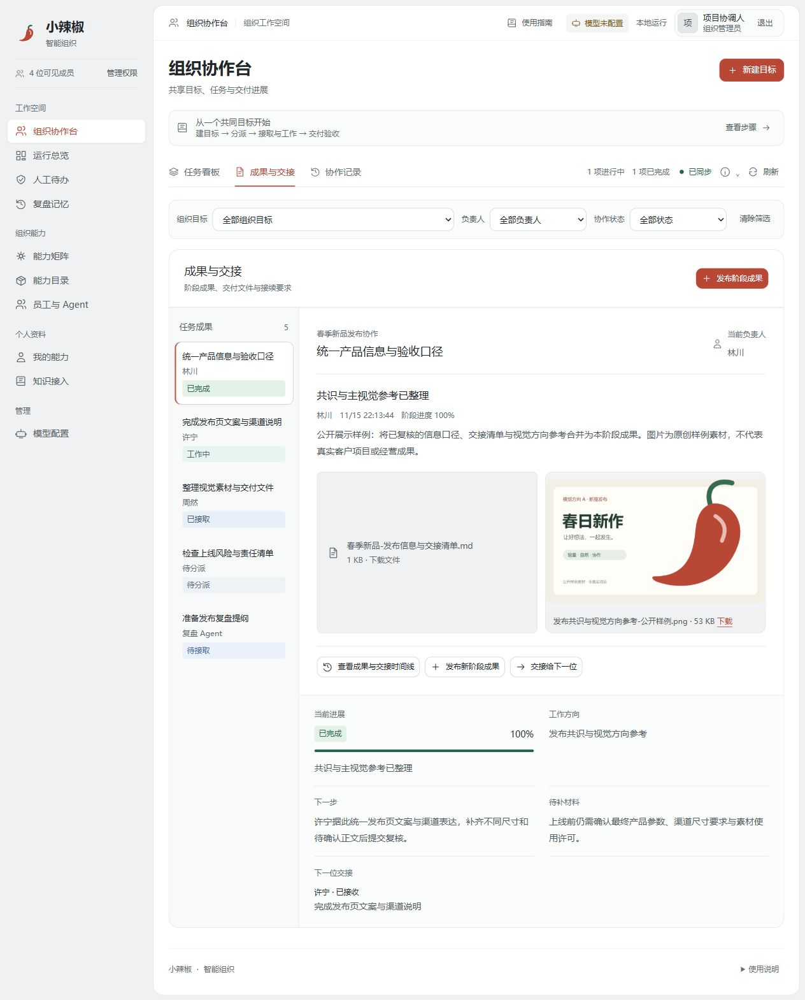

# 智能组织

[English](README.en.md)

[适用场景](#可以用在哪些工作里) · [协作流程](#一次完整协作分成六步) · [原子能力](#让人的专长和-agent-能力都能被理解) · [协调成本](#希望降低哪些协调成本) · [开始使用](#开始使用) · [授权](#授权与参与) · [支持](#支持项目)

**让人和 AI Agent 按专长分工，让目标、成果与交接连成完整的协作过程。**

智能组织是面向人机协作的组织工作空间。它把目标拆成有负责人、有输入输出、有验收依据的任务，让擅长某项工作的人专注贡献，也让 Agent 承担适合它的分析、起草与整理工作。

我们希望探索一种新的办公形式：协作不再主要依靠上下级逐层口头传达，也不必把“坐在一起”当作工作能够接续的前提。每个人都能看到共同目标，理解自己的贡献如何连接上游与下游，通过明确的能力、成果和责任参与工作。**无固定办公场地的多人协作是产品愿景，当前版本先把本机工作空间里的协作闭环做好。**

这里的“智能”不仅指接入模型，也指让组织更清楚地知道：谁能做什么、谁正在做、做到哪一步、还缺什么、由谁验收，以及下一步交给谁。个人的一项专长可以成为团队可发现、可验证、可调用的原子能力，而不必依赖某个人记住所有人的经验。

> **当前可用范围**：已提供 Windows x64 桌面版与源码版，支持同一台电脑、同一工作空间中的多账号协作。服务仅监听本机 `127.0.0.1`；跨电脑、局域网和互联网协作尚未实现。



*中文界面的虚构公开样例，非实际项目成果。中文与英文版功能一致。*

<details>
<summary>查看阶段成果、证据文件与下游交接</summary>



成果不只是一句“已完成”：它可以包含阶段说明、图片、视频、文件、待补材料和下一步安排。交接记录说明传递了哪个版本、交给谁，以及对方是否接收。截图同样使用虚构公开样例。

</details>

## 从个人做事，到共同完成一件事

很多工作并不缺人，也不缺工具，而是缺少一条能被所有参与者理解的协作线索。任务散在聊天里，资料散在文件夹里；负责人知道背景，执行人只收到一句要求；上一环节认为已经交付，下一环节还在等可用材料。引入 AI 后，如果只有更多零散的聊天结果，这些问题仍然存在。

智能组织把这些信息放回工作的上下文：

- **目标共享**：说明为什么做、希望得到什么、如何判断完成，让参与者围绕同一个结果协作。
- **责任明确**：任务指定到具体成员或 Agent。名单不因资质暂缺而隐藏，未满足的执行条件会直接说明。
- **过程可见**：接取、开工、公开进展、提交、验收与退回分别记录，区分“有人负责”“正在处理”和“已经认可”。
- **成果可交接**：把阶段结果、证据与下一步一起交给下游，而不是只转发一句完成通知。
- **经验可积累**：把本次工作的依据、问题和复盘留下来，为后续任务提供可追溯的参考。

它适合需要明确分工、连续交付和人机配合的工作。既可以从一个目标、两三名参与者开始，也可以逐步补充人员能力、资料与流程。当前默认流程是固定五步模板，也支持手工定义任务依赖；系统不会自动替组织决定所有职责和业务规则。

## 可以用在哪些工作里

以下是**适配场景示例，不是预装业务模板，也不代表已经接通对应业务系统**。具体任务、能力、资料和验收标准需要团队自己配置。涉及发布、采购、客户沟通等外部动作，仍由人员在相应系统中完成。

| 场景 | 人员与 Agent 如何分工 | 可形成的交接成果 |
| --- | --- | --- |
| 内容与品牌营销 | 研究人员提供来源；Agent 整理要点、起草内容；编辑与品牌负责人核对事实和表达。 | 选题说明、带来源的文案、修改意见、待发布清单。 |
| 新品或服务发布 | 产品人员确认信息，市场人员组织材料，设计人员制作视觉；Agent 协助整理口径和清单。 | 已确认的产品资料、传播素材、发布前检查记录。 |
| 设计与创意协作 | 需求方给出约束，设计师制作方案，评审人反馈；Agent 协助梳理文案和评审要点。 | 设计说明、图片或视频版本、修改依据、采用方案。 |
| 软件需求与测试 | 产品、开发和测试人员分别负责需求、实现和验证；Agent 起草需求说明或测试用例文本。 | 验收条件、实现说明、缺陷证据、测试记录。 |
| 调研与专题研究 | 研究人员收集并核实资料；Agent 汇总给定材料；专业人员检查结论和不确定性。 | 来源清单、比较分析、待核实问题、研究结论。 |
| 活动与日常运营 | 运营负责人拆分筹备事项，成员推进各环节；Agent 整理计划、说明和复盘初稿。 | 执行清单、阶段进展、现场资料、复盘记录。 |
| 客户资料整理 | 业务人员选择有权使用的材料；Agent 辅助归纳需求；负责人核对遗漏与敏感内容。 | 需求摘要、问题清单、沟通准备材料、后续行动。 |
| 项目与服务交付 | 各专业成员完成自己的环节，项目负责人协调依赖与验收；Agent 辅助整理交付说明。 | 阶段交付包、验收意见、遗留事项、下阶段输入。 |
| 组织知识沉淀 | 有经验的成员提供方法与案例；Agent 协助整理；审核人确认适用范围和原文依据。 | 工作方法、操作说明、能力证据、可复用资料。 |
| 培训与课程制作 | 专家提供内容，课程人员组织结构，讲师与审稿人验证；Agent 辅助起草提纲和练习。 | 课程大纲、讲义、示例、评审意见、授课材料。 |
| 行政与采购资料 | 需求人员提交条件，相关成员收集报价与资料；Agent 整理比较表，负责人作业务判断。 | 需求说明、报价材料、比较依据、待决策事项。 |
| 跨职能专项工作 | 不同岗位围绕共同结果分工，负责人协调前置条件；Agent 辅助形成阶段总结。 | 分工记录、依赖清单、阶段成果、后续责任安排。 |

同一套工作方式可以服务不同业务，但不会替代专业判断。设计成果由设计工具产生，软件验证由实际测试完成，采购和付款仍走原有决策程序；工作台负责把相关责任、过程与证据连接起来。

## 一次完整协作，分成六步

| 步骤 | 要做的事 | 留下什么 |
| --- | --- | --- |
| **1. 定义目标** | 写清背景、预期结果、验收标准；使用默认流程，或手工设置任务与依赖。 | 能被参与者共同理解的目标和完成条件。 |
| **2. 指定分工** | 从员工与 Agent 完整名单中选择执行者，检查能力、授权、可用性与前置条件。 | 明确的负责人，以及执行前尚需补齐的条件。 |
| **3. 接取与工作** | 成员接取并开始自己的任务；负责人在运行总览中发起 Agent 执行。 | 接取、开工和过程记录，而不只是一个分派结果。 |
| **4. 发布阶段成果** | 说明方向、阶段、进展、结果、待补材料与下一步，选择需要公开的附件。 | 团队可查看的进展和证据；发布进展本身不等于完成任务。 |
| **5. 提交与验收** | 普通人工任务提交交付，由另一位有权人员验收或退回；需要人审的 Agent 工作应安排人工验收节点。 | 明确的认可、退回理由与修订记录。 |
| **6. 交接与复盘** | 把已完成上游的指定成果交给下游执行者，记录接收或退回，并整理经验。 | 可追溯的交接关系、遗留事项与复盘资料。 |

<details>
<summary>具体示例：完成一套新员工入职资料</summary>

这是一个虚构的流程示例，不是产品内预装项目。

1. **负责人定义结果**。目标是形成岗位说明、首周安排和常见问题三份资料，验收要求是依据明确、职责无冲突、待确认项被单独列出。
2. **按专长分派**。熟悉岗位的人负责提供原始说明；擅长文字组织的成员负责成稿；Agent 整理已提供材料并生成提纲；另一位负责人负责核对。
3. **从同一份背景开始**。成员导入可用的文本资料，接取自己的任务。供 Agent 使用的资料须属于目标创建者，或已作为组织知识导入；其他成员的私人文档不会自动进入上下文。Agent 使用给定内容起草，缺少的制度信息留在“待补材料”中，由相关人员补充，而不是编造答案。
4. **边推进边留成果**。执行人发布阶段说明，附上文档与需要讨论的图片，标明下一步。其他成员可据此了解进展，不必反复询问整段背景。
5. **先核对，再认可**。普通人工成稿任务提交后，由其他有权人员验收。不合格内容带着理由退回。Agent 的文本输出本身不是制度已获批准的证据，应进入后续人工核验环节。
6. **明确交接范围**。已完成的资料版本交给下游培训任务的执行者，对方确认接收或说明缺少材料。接收资料不会自动开始培训任务，也不代表培训已经完成。最后把本轮遗漏和改进建议写入复盘。

</details>

## 工作做到哪里，要有清楚的标准

任务状态、公开进展、交付验收与交接回执分别表达不同事实，不用一个百分比代替全部判断。

| 状态或记录 | 应如何理解 |
| --- | --- |
| 待分派 | 尚未确定执行者，负责人需要指定人员或 Agent。 |
| 待接取 / 已接取 | 人员已被分派；接取表示本人确认承担，尚不等于已经开工。 |
| 工作中 | 任务已开始，可以更新公开进展、发布阶段成果。 |
| 待验收 | 普通人工任务已提交交付，等待有权的其他人判断是否满足标准。 |
| 已完成 | 当前任务按对应执行协议完成。Agent 文本节点完成不等于每个结果都已人工审核。 |
| 阻塞、失败或待补条件 | 有明确条件需要处理；不能把“已经分派”理解为“现在一定能执行”。 |
| 交接待接收 / 已接收 / 已退回 | 描述资料传递的回执，不代替任务分派、开工或验收。 |

人员只能接取和处理分派给自己的任务。负责人可以协调分工，但不能冒充另一位成员接取或签署其人工节点。普通人工交付不能由提交人自行验收；需要特别人工决策的节点，也要由指定人员作出判断。

交接以**已完成的上游任务、明确的成果版本、已分派给合资格员工的直接下游任务**为依据。接收者可以确认资料可用，也可以说明缺漏并退回。交接不会改变责任人，不会自动解锁其他前置条件。上游返工或产生新的已完成任务产物、下游改派后，尚待接收的旧交接可能无法再接收，界面会说明原因；已接收的历史记录保留，单纯发布新的阶段动态也不会撤销原交接。

共享状态约每两秒同步一次。多人同时修改时，版本冲突会保留当前打开表单的输入；读取新版本后，由用户核对再提交。断线时保留页面已有内容，避免把过期状态当成新的成功结果。

## 让人的专长和 Agent 能力都能被理解

**原子能力是一项边界清楚、可以检查结果的工作能力**。与“懂运营”“会用 AI”这样的笼统标签相比，“根据给定资料整理客户需求摘要，并标出缺失信息”更容易判断是否适合某个任务。

能力目录和矩阵把成员与 Agent 放在同一个分工视野中，但保留不同的依据：

- **对人**：可以申报能力与等级，引用本地资料中的真实原文作为证据，再由管理员核验。自报、系统关键词建议、已核验与未通过分别显示；自评等级不是资质认证。
- **对 Agent**：记录能力介绍、提供方式与运行模式。能力声明说明它打算承担什么，不代表已经经过充分实测，也不代表外部工具已经接通。
- **对执行权限**：能力登记、人工核验和任务授权分开管理。确认某人会做一项工作，不会自动授予所有相关操作权限。

Skill 用结构化说明描述能力：名称与用途、输入、输出、验收条件、操作步骤、边界、工具声明和示例。支持带平面 frontmatter 元数据的 Markdown / `SKILL.md`，或符合规定结构的 JSON 文本导入；先预览并补齐输入、输出、验收等说明，再登记到具体提供者，保留来源文件以便回看。

给员工导入 Skill 会形成待核验申报，给 Agent 导入会登记声明。**上传 Skill 不会自动安装工具、运行脚本或获得授权**。能力需要通过实际任务与证据逐步验证，不能仅凭一份漂亮说明就视为可用。

分派时可以选择完整名单中的员工或已登记 Agent，即使条件暂未齐全。界面会说明缺少的能力、核验、授权、可用性、前置依赖或模型条件。这样既能先明确责任，也不会为追求“分派成功”而绕过执行检查。

## 知识、模型与数据如何配合

### 把资料接入上下文

支持导入本地 Markdown、文本文件或粘贴内容。导入的是当时的**资料快照**，不会自动跟踪原文件变化。个人资料与组织资料有各自访问范围，能力申报可以引用来源中的真实摘录。

公开成果与私人知识不是一回事。上传附件先暂存给上传者，发布时选择的附件才进入组织公开成果；已有私人资料不会因此自动公开。获授权的下游执行者可以取得已完成前置任务的结果作为上下文，因此发布或提交前仍应判断内容是否适合该协作范围。

### 按需要选择模型

管理员可以在模型设置中配置本地模型服务，或兼容协议的云端 API，填写服务地址、模型和凭据。连接测试发送固定测试文本，保存启用后才成为工作空间的配置；一次连通测试不等于实际业务任务已经通过验证。

未配置模型时仍可组织人工工作，Agent 执行会明确提示所缺条件。当前 Agent 主要处理给定文本的分析、起草、检查与复盘，不会自行浏览网页、执行任意脚本、发送消息或调用外部业务系统。图片与视频可作为成果上传、预览和下载，不代表具备自动识别、剪辑或生成能力。

使用云端模型时，执行所需资料会发送到所配置的服务，并可能产生服务商费用。工作空间里的 Agent 预算是**调用尝试次数，失败尝试也计入**，不是费用额度或 Token 上限。

### 本地保存，有明确边界

账号、任务、资料与附件保存在运行工作空间的电脑上；无需邮箱或云端账号即可注册，密码加盐哈希保存。个人资料、组织公开信息与任务交付按各自权限访问；具体数据目录见下方使用说明，可据此安排备份。

## 希望降低哪些协调成本

智能组织提供的是减少重复沟通与资料散落的机制。实际效果取决于任务描述、成员维护记录的习惯、资料质量和团队流程。可用任务流转时间、追问次数、资料查找时间和返工次数观察实际改善。

| 成本 | 常见问题 | 对应机制 |
| --- | --- | --- |
| 信息传递 | 背景被逐层转述，重要约束遗漏。 | 目标、输入与验收条件跟随任务保留，参与者查看同一份上下文。 |
| 工作对齐 | 每个人都在忙，却对完成标准理解不同。 | 在开始前明确结果、前置关系与验收责任，退回时保留具体理由。 |
| 找人与分工 | 依赖熟人记忆寻找合适的人，能力难被发现。 | 通过能力矩阵、证据与完整名单选择执行者，并看到尚缺条件。 |
| 重复解释 | 换人接手就要重新讲一遍背景。 | 原始说明、阶段记录、成果和下一步一起保留，减少重新组织说明的负担。 |
| 搜索资料 | 文件与聊天分散，不清楚哪个版本对应任务。 | 资料来源和已发布成果挂在相应工作上下文中，交接指向明确版本。 |
| 等待与追问 | 不知道是否有人接取、卡在哪里、该找谁补充。 | 分开显示分派、接取、工作、待验收与阻塞，公开记录待补材料。 |
| 返工 | 问题到交付末尾才暴露，修改依据丢失。 | 阶段成果、明确标准与独立验收，让问题和修订依据尽早可见。 |
| 交接 | 上游以为完成，下游认为材料还不能用。 | 指定成果、接收对象与回执；不完整时带原因退回，避免默认对方已收到。 |
| 复盘与重复起草 | 经验留在个人记忆中，下次从头整理。 | 保留过程与复盘；让 Agent 辅助处理已有材料，把人的精力留给判断和改进。 |

这些机制不会消除协商，也不会替代管理责任。它们让必要的讨论有共同依据，让可以被记录、查阅和复用的信息少一些反复传达。

## 使用边界与后续方向

当前更适合在本机验证协作流程、开展小范围任务实践，以及在源码上继续开发。复杂业务仍需团队定义规则和专业人员判断，不能将任务状态视为财务批准、法律结论或外部系统已执行的证明。

后续方向包括跨设备工作空间、适合远程协作的身份与访问控制、部署与备份工具，以及更可审计的能力和外部工具接入。这些方向都需要相应的权限、运行和安全设计，**属于规划，不是已交付功能或完成时间承诺**。

无论扩展到什么场景，基本原则保持一致：把工作分给具体提供者，明确输入和结果，让过程与证据可追溯，让重要判断由有权的人承担。

## 开始使用

当前桌面客户端名称为**小辣椒**，属于智能组织项目。中文与英文版功能一致，可选择适合自己的语言。

**直接使用**：请选择对应语言的 Windows x64 安装包，无需另装 Python 或 Node.js。

| 语言 | Windows x64 安装包（推荐） | 完整源码 ZIP |
| --- | --- | --- |
| 简体中文 | [下载中文安装包](https://github.com/lizhenjie137/intelligent-organization/releases/download/v0.1.0/Xiaolajiao-zh-0.1.0-Windows-x64-Setup.exe) | [下载中文源码](https://github.com/lizhenjie137/intelligent-organization/releases/download/v0.1.0/xiaolajiao-zh-source-2026-11-15.zip) |
| English | [Download English installer](https://github.com/lizhenjie137/intelligent-organization/releases/download/v0.1.0/Xiaolajiao-en-0.1.0-Windows-x64-Setup.exe) | [Download English source](https://github.com/lizhenjie137/intelligent-organization/releases/download/v0.1.0/xiaolajiao-en-source-2026-11-15.zip) |

[查看 v0.1.0 发布说明与全部附件](https://github.com/lizhenjie137/intelligent-organization/releases/tag/v0.1.0)。

如需查看实现、修改或二次开发，可下载对应语言的完整源码 ZIP。源码运行需要 Windows、Python 3.11+ 与 PowerShell；自行构建桌面版另需 Node.js 22.12+。

### 安装版

1. 运行对应语言的 Windows x64 安装包，按提示安装并启动小辣椒。
2. 在注册页填写显示名、用户名和至少 12 个字符的密码，再确认密码。不需要邮箱，也没有预设账号。
3. 空工作空间的首个注册账号自动成为管理员，后续注册账号为成员；角色由服务端决定。
4. 创建组织目标，补充成员能力或资料，按任务分派并开始协作。需要 Agent 时，再由管理员配置并测试模型。

### 源码版

解压对应语言的源码包，在其根目录执行：

```powershell
.\Install.ps1
.\Start-Xiaolajiao.ps1
```

如果通过 Git 克隆整个仓库，请先进入所选语言目录，再运行上面的安装与启动命令。例如使用中文版：

```powershell
git clone https://github.com/lizhenjie137/intelligent-organization.git
cd intelligent-organization\editions\zh
```

英文版进入 `editions/en`。仓库根目录本身不是应用运行目录；独立源码 ZIP 则直接在解压后的目录运行。

浏览器入口为中文 `http://127.0.0.1:8769`、英文 `http://127.0.0.1:8771`。打开后按同样流程注册。若端口已被占用，启动脚本会停止并提示，不会把已有服务当作当前工作空间；可改用一个空闲端口，例如：

```powershell
.\Start-Xiaolajiao.ps1 -Port 8782
```

源码数据位于包内 `data/workspace/`。安装版默认数据位于 `%LOCALAPPDATA%\Xiaolajiao\zh\workspace` 或 `en\workspace`。**安装版与源码版、中文与英文版的数据相互独立，不会自动迁移**。备份时应保留自己的工作空间数据；关闭桌面窗口会停止该窗口对应的后台服务。

## 授权与参与

允许下载、安装、使用与二次开发；**未经授权，不得售卖原软件或衍生版本**。这是 source-available 授权，具体条款见 [LICENSE](LICENSE) 与 [LICENSING.md](LICENSING.md)。第三方组件保留各自独立许可证。

欢迎提出真实协作场景、流程问题、文档改进和可复现的缺陷反馈。说明使用的版本、操作步骤、预期结果与实际结果，比只有一张报错截图更容易定位问题；提交材料前请移除个人信息、密钥与私人工作数据。涉及权限、外部调用或数据迁移的改动，应同时说明影响范围与验证方式。

由 **执棋会AI · Zhiqihui AI** 开发。维护者：[lizhenjie137](https://github.com/lizhenjie137)。

## 支持项目

<p align="center">
  <strong>微信支付</strong><br><br>
  
</p>

<p align="center">感谢支持，开源不易</p>

<p align="center"><a href="https://qr.alipay.com/tsx1311822nwtvpok989m8c">通过支付宝支持</a></p>
