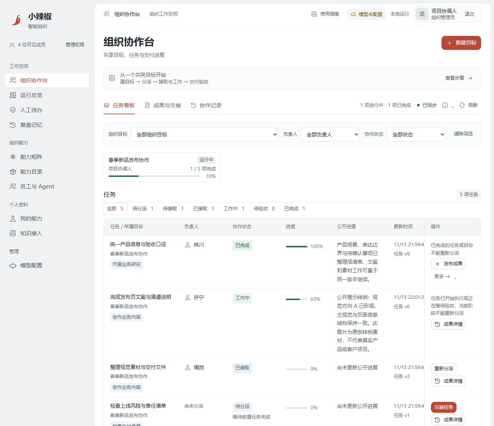
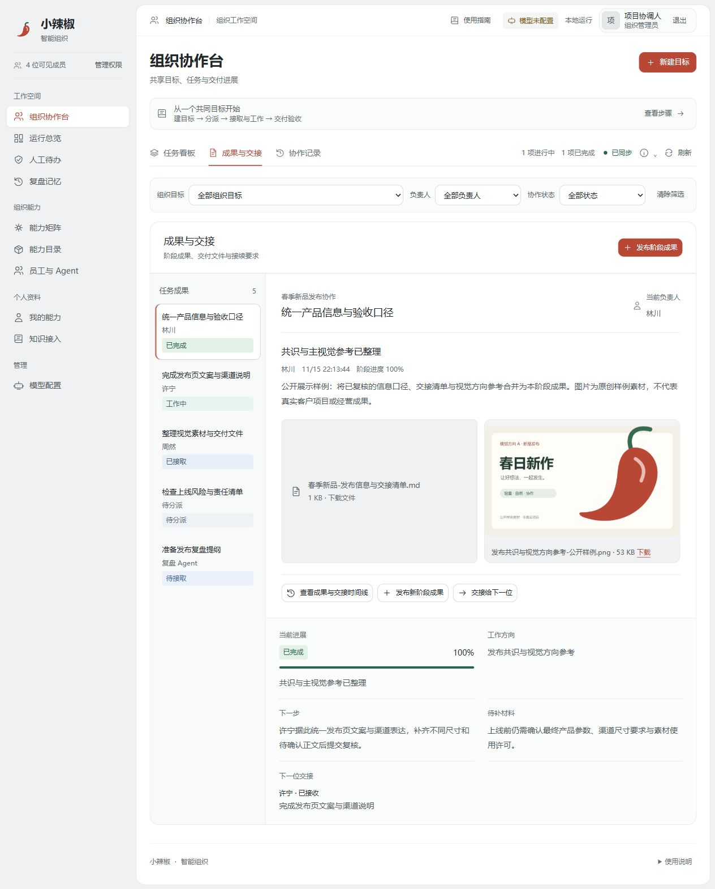

# Xiaolajiao · Intelligent Organization

Turn individual expertise into work a team can discover, assign and deliver.

Xiaolajiao is a collaboration workspace for people and AI Agents, created by **Zhiqihui AI (执棋会AI)**. It connects shared goals, named assignees, progress, evidence and handoffs in one traceable workflow. The aim is to reduce repeated verbal relays and make four questions easy to answer: who owns the work, where does it stand, what is missing, and who takes it next?

**This delivery includes a Windows x64 desktop installer and editable source with an English interface. The installer has been built and installation has been verified.** Both modes use a local multi-account workspace. Access from other computers and internet deployment are not implemented. [中文介绍](README.zh-CN.md)

## One connected workflow

**Shared goal → Tasks → Named member or Agent → Accept and work → Public updates and deliverables → Independent review → Handoff → Retrospective**

- **Shared context:** everyone can see organizational goals, assignees, task states and public progress. Private documents and original deliverables retain their access controls.
- **Direct assignment:** choose a specific member or Agent from the searchable full roster. Missing capability, permission, availability or dependency requirements remain visible instead of hiding the provider.
- **Evidence alongside progress:** publish work direction, stage, next steps and information needed, with images, video and files.
- **Separate delivery and review:** submission is not approval. Authors cannot independently approve their own deliverables; receiving handoff materials does not complete the next task.
- **Capabilities with contracts and evidence:** describe inputs, outputs, method and acceptance criteria. Member claims, verification and execution permissions are separate. An Agent declaration does not mean its tools are connected.
- **Traceable learning:** connect retrospectives to source tasks and review records without presenting candidate lessons as verified knowledge.

Our longer-term direction is work that does not depend on a fixed office location, with people contributing through the work they do best. This release establishes shared responsibility and handoffs first. Remote deployment belongs to the [roadmap](ROADMAP.md), not the current feature set.

## Workspace screenshots

These screenshots show **fictional public examples in the Chinese interface, not actual project outcomes**. Both editions have the same functionality; the English edition provides corresponding English controls.



Shared tasks: see goals, named assignees, the division of work between people and Agents, and synchronized states in one place.



Deliverables and handoffs: keep stage notes, images and files together, with a clear record of receipt and what happens next.

## Desktop installer and source

To use the workspace, [download the Windows x64 installer](https://github.com/lizhenjie137/intelligent-organization/releases/download/v0.1.0/Xiaolajiao-en-0.1.0-Windows-x64-Setup.exe). To modify the implementation, [download the complete source ZIP](https://github.com/lizhenjie137/intelligent-organization/releases/download/v0.1.0/xiaolajiao-en-source-2026-11-15.zip). See the [v0.1.0 release notes and all assets](https://github.com/lizhenjie137/intelligent-organization/releases/tag/v0.1.0).

End users can run `Xiaolajiao-en-0.1.0-Windows-x64-Setup.exe` without installing Python or Node.js separately. Developers can run and modify this source package; building the desktop edition requires Python 3.11+, Node.js 22.12+ with npm, and PowerShell.

Desktop accounts and data default to `%LOCALAPPDATA%\Xiaolajiao\en\workspace`, separate from the source edition's `data/workspace/` and any existing workspace. Data is not automatically migrated. See [desktop use and build instructions](docs/DESKTOP.md).

## Run the source on Windows

Requires **Python 3.11 or newer**, PowerShell, and internet access for the initial dependency installation. Run these commands from the directory containing this README. If you cloned the entire GitHub repository, first enter `editions/en`:

```powershell
.\Install.ps1
.\Start-Xiaolajiao.ps1
```

Open <http://127.0.0.1:8771>. The first visit defaults to registration. The first account becomes the workspace administrator; subsequent registrations create members. There are no preset credentials and no email or cloud identity requirement. Passwords must contain at least 12 characters.

```powershell
# Choose another local port if the default is occupied:
.\Start-Xiaolajiao.ps1 -Port 8783
```

Then open <http://127.0.0.1:8783>. If the original port belongs to another workspace, its accounts and data are separate from this source package. The launcher refuses an occupied port; it does not stop or take over the existing service.

The server listens on loopback only. This address is not an internet deployment or an address another computer can use. Press `Ctrl+C` to stop the service; local data is retained.

Each language package can be copied and run independently. Accounts, workspace data and model settings are separate and do not synchronize between packages.

## Your first workflow

1. Register and enter the organization workspace. Each participant uses an individual account; administrators can also create member accounts.
2. Import Markdown or text in Knowledge. Cite source evidence when claiming capabilities; administrators verify claims and grant execution permissions separately.
3. Create a goal with context and acceptance criteria. A five-step template is supplied, with optional custom task dependencies.
4. Assign a named member or Agent. Responsibility can be assigned before execution requirements are met; resolve those requirements before acceptance, work or an Agent run.
5. Publish progress and interim deliverables. Submit completed work for independent review by another authorized person.
6. Hand a selected version of completed upstream work to the assignee of a directly dependent task, retaining the receipt or request for more information.

The in-app User guide and [full user guide](docs/USER-GUIDE.md) explain the controls.

## Local models and cloud APIs

An administrator uses Model settings to enter a local or cloud endpoint, protocol, model name and any required key, then tests, saves and activates the connection. Tests send fixed text without organization records; cloud tests may incur a small charge. **A successful draft test does not save settings or establish that business work has been completed.**

Human collaboration is available before a model is configured. Agent tasks do not silently substitute rule-generated content for real model output. When model execution is enabled, the required task material is sent to the configured service. The current integration primarily produces text; uploading a Skill does not install dependencies, execute its scripts, send messages or modify external business systems.

The integration uses pinned official packages: `deepseek-harness-sdk==0.2.2rc2` and `deepseek-harness-runtime-bin==0.2.2rc2`. See [requirements.lock.txt](deepseek-harness-base/requirements.lock.txt) and the [architecture notes](docs/ARCHITECTURE.md).

## Data and checks

`data/workspace/` holds this package's accounts, organizational records, attachments and runtime data. Passwords are stored as salted hashes; the browser uses a session cookie. Keep `data/`, model credentials, uploaded materials and virtual environments out of source control.

Developer checks are below. Frontend checks and desktop development use Node.js 22.12 or newer:

```powershell
.\deepseek-harness-base\.venv\Scripts\python.exe -X utf8 -m unittest discover -s tests -q
node --check web/coordination.js
node --test tests/auth_frontend.test.cjs tests/coordination_assignment.test.cjs
```

These checks use isolated data and local fixtures. They do not require real business accounts or paid model credentials.

## Source and licensing

This is **source-available software (no unauthorized resale)**. Downloading, installing, using and modifying the application is permitted; selling the original application or derivative versions requires authorization. Consult [LICENSE](LICENSE) and [LICENSING.md](LICENSING.md) for the governing terms and release status. This is not a claim of an MIT, Apache or OSI-approved open-source license.

Third-party components retain their own licenses; see [THIRD_PARTY_NOTICES.md](THIRD_PARTY_NOTICES.md).

Created by **Zhiqihui AI / 执棋会AI**. This folder contains editable source. The Windows x64 installer and source ZIP are available from the [v0.1.0 release page](https://github.com/lizhenjie137/intelligent-organization/releases/tag/v0.1.0).
