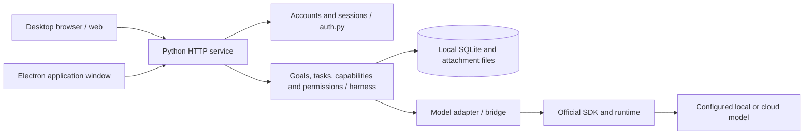

# Architecture

Xiaolajiao uses a single-process, locally hosted, multi-account business service with a web interface. The source also includes an Electron shell and PyInstaller backend packaging; Windows x64 installers have been provided and installation verified in this delivery. The Chinese and English packages share the business architecture but install independently and keep separate accounts and data. There is no cross-package synchronization service.

## Components and data flow

| Path | Responsibility |
| --- | --- |
| `web/` | Plain HTML, CSS and JavaScript for collaboration, capabilities, knowledge, model settings and help |
| `desktop/`, `Build-Desktop.ps1` | Electron shell, backend packaging and Windows x64 NSIS build workflow |
| `server.py` | Same-origin HTTP APIs, authentication, static resources and attachment streaming |
| `auth.py` | Local registration, sign-in, role binding and sessions |
| `harness/engine.py` | Workflow dependencies, task states, budgets, assignment and execution permission checks |
| `harness/workboard.py` | Progress publications, staged attachments, visibility and handoff records |
| `harness/runtime.py` | Injects the actual model adapter into the main workspace and reports unavailable configurations |
| `deepseek-harness-base/bridge/` | Official SDK calls, connection configuration and restricted runtime integration |
| `examples/` | Workflow and Skill format examples, not business evidence |
| `tests/`, `scripts/` | Isolated regression, HTTP and runtime checks |
| `data/workspace/` | Private data generated after launch; excluded from source distribution |

The web frontend has no build step. `Install.ps1` installs source-run dependencies into an environment inside the package. `Build-Desktop.ps1` uses Python 3.11+ and Node.js 22.12+ to build the desktop app. Desktop installers include their runtime, so end users do not need those development environments.

## State, visibility and concurrency

`/api/coordination` provides public organizational goals, tasks, the member directory, progress, published updates and handoffs. `/api/state` supplies the complete data the current account is permitted to access. Seeing a task does not imply access to every private document or original deliverable.

The client polls public state about every two seconds. Organizational state has a revision; tasks and handoffs also have versions. Writes include the expected version. A conflict returns HTTP 409 and requires review before retrying. The frontend preserves drafts and pauses writes during disconnection. Model availability is refreshed independently of business revisions so configuration changes do not rewrite task history.

Assignment is separate from execution eligibility. The complete roster can include unverified, unauthorized or inactive members, while acceptance, work, submission and Agent execution still undergo server-side checks. Disabled controls help users understand state; they are not the authorization boundary.

## Identity and storage

The first registered account becomes an administrator; subsequent accounts become members. Client-supplied role fields cannot elevate privileges. Each member account is bound to a human executor identity; Agents do not sign in with employee passwords.

Account and work databases reside in the private data directory. Passwords use PBKDF2-HMAC-SHA256 with individual random salts; only hashes of persisted session tokens are stored. Session cookies are HttpOnly, with local Host and request Origin checks. The service binds to `127.0.0.1`; these controls are not a claim of internet-deployment readiness.

Attachments are uploader-only while staged and become organization-visible on explicit publication. Video supports range reads. Knowledge documents and original deliverables retain their own permissions, independent of public board visibility.

## Models and Skill boundaries

The integration pins `deepseek-harness-sdk==0.2.2rc2` and `deepseek-harness-runtime-bin==0.2.2rc2`. The bridge actually calls the SDK and uses the configured compatible model protocol; the model does not have to come from the runtime's supplier.

Unavailable or unconfigured connections fail explicitly. Only an explicitly selected rule mode used for development verification produces labeled rule-generated output. Fixed connection-test text is separate from actual task material. Saved model keys on Windows use operating-system protection and are not shown in the interface.

A Skill is a capability specification and source record. Inputs, outputs, acceptance criteria, method, limitations, tool declarations and examples describe the capability and may inform text-task context. Uploading does not execute scripts or install tools. The current bridge restricts filesystem, terminal, subprocess and external-tool capabilities. Real business actions would need separate integration, authorization and validation.

## Current deployment boundary

- One local service supports multiple accounts; this is not a hosted network collaboration service.
- Windows x64 desktop packaging and installers are provided. Automatic updates, HTTPS deployment, SSO, email integration and external business connectors are not delivered product features.
- Workspace persistence is local; configured cloud model calls may transmit required task material. Source packages exclude accounts, sessions, credentials, uploaded materials, downloaded models and existing business records.
- Tests cover concrete workflows and boundaries; they do not establish production deployment readiness or security certification.

See the [roadmap](../ROADMAP.md) and the governing [LICENSE](../LICENSE) and [LICENSING.md](../LICENSING.md).
