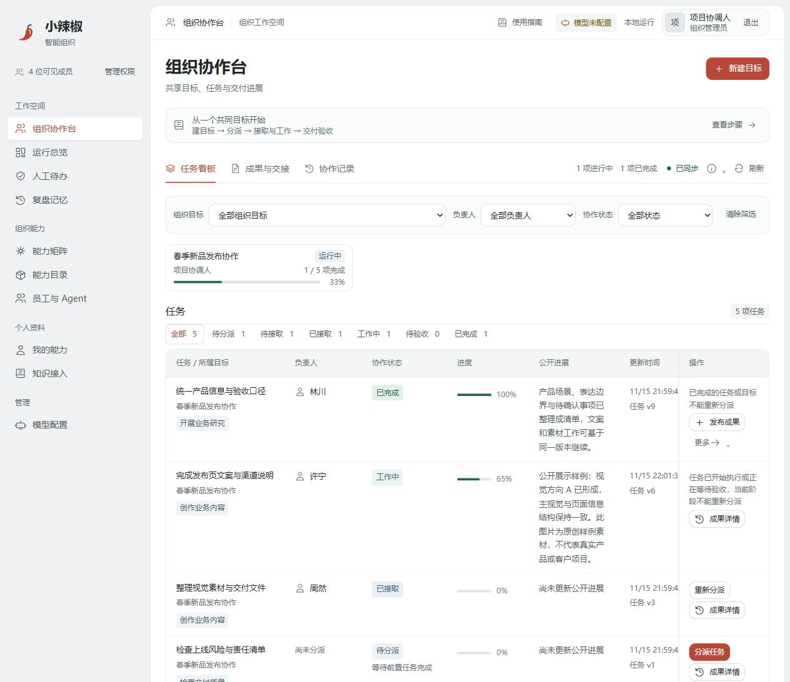
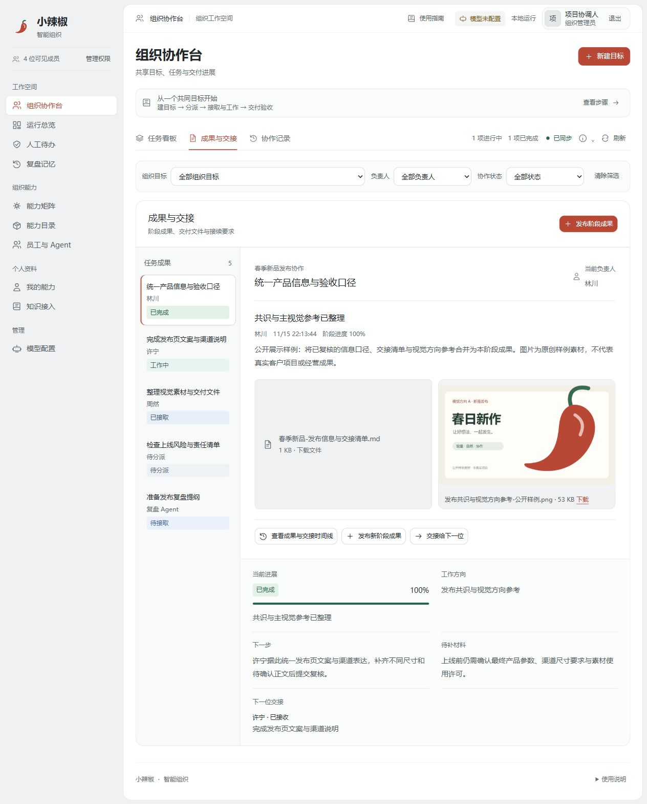

# 小辣椒 · 智能组织

让每个人的专长，都能成为组织里可发现、可分派、可交付的能力。

小辣椒是一款面向人与 AI Agent 协作的办公工作台，由 **执棋会AI（Zhiqihui AI）** 开发。它把共同目标、具体任务、负责人、工作进展、成果证据和下一步交接放在同一条可追踪的工作流程中，减少反复口头转述，让参与者看清“谁在做、做到哪、还缺什么、接下来交给谁”。

**本次已提供中文界面的 Windows x64 桌面安装包与可修改源码包，安装程序已完成构建和安装验证。** 两种形式都运行本机多账号协作流程；跨电脑访问和互联网部署尚未实现。[English introduction](README.en.md)

## 一条完整的协作链路

**共同目标 → 拆分任务 → 指定员工或 Agent → 接取与工作 → 公开进展与阶段成果 → 独立验收 → 交接 → 复盘**

- **目标共享**：全员查看组织目标、任务状态、负责人和公开进展；交付正文与私人资料仍按权限访问。
- **明确分派**：直接选择具体员工或 Agent。完整名单可搜索，能力、授权、停用或依赖等待补条件不会让人从名单中消失。
- **成果有据可查**：发布工作方向、当前阶段、下一步和待补材料；图片、视频与文件可随成果一起共享。
- **交付与验收分开**：提交结果不等于完成验收；提交人不能独立验收自己的交付。接收交接资料也不会自动完成下游任务。
- **能力有说明、有证据**：原子能力用输入、输出、步骤与验收标准描述。员工申报、管理员核验和执行授权分开；Agent 的能力声明也不等于工具已经接通。
- **保留组织记忆**：复盘连接源任务、交付与评审记录；候选经验不被包装成已验证知识。

我们的方向是支持不受固定办公场地限制的人机协作，让擅长一项工作的人能够专注贡献。当前版本先把共享流程、责任与交接做清楚；远程部署能力列在[路线图](ROADMAP.md)，不属于当前交付。

## 工作界面

以下两张截图使用**中文界面的虚构公开样例，非实际项目成果**。中文与英文版功能一致，英文版提供对应英文界面。



共同任务：在一处查看目标、具体负责人、员工与 Agent 的分工及同步状态。



成果与交接：把阶段说明、图片和文件放在一起，明确资料是否已被接收，以及下一步如何继续。

## 桌面安装版与源码版

直接使用请[下载 Windows x64 安装包](https://github.com/lizhenjie137/intelligent-organization/releases/download/v0.1.0/Xiaolajiao-zh-0.1.0-Windows-x64-Setup.exe)；如需修改实现，可[下载完整源码 ZIP](https://github.com/lizhenjie137/intelligent-organization/releases/download/v0.1.0/xiaolajiao-zh-source-2026-11-15.zip)。[v0.1.0 发布说明与全部附件](https://github.com/lizhenjie137/intelligent-organization/releases/tag/v0.1.0)。

普通用户可使用 `Xiaolajiao-zh-0.1.0-Windows-x64-Setup.exe`，无需自行安装 Python 或 Node.js。开发者可运行和修改本源码包；构建桌面版需要 Python 3.11+、Node.js 22.12+（含 npm）和 PowerShell。

桌面账号与数据默认在 `%LOCALAPPDATA%\Xiaolajiao\zh\workspace`，与源码的 `data/workspace/` 及已有工作空间分开，不会自动迁移。详见[桌面使用与构建说明](docs/DESKTOP.md)。

## 从源码在 Windows 上开始

需要 **Python 3.11 或更新版本**、PowerShell，以及首次安装依赖时的网络连接。从本文件所在目录执行；如果克隆了整个 GitHub 仓库，请先进入 `editions/zh`：

```powershell
.\Install.ps1
.\Start-Xiaolajiao.ps1
```

打开 <http://127.0.0.1:8769>。首次进入默认显示注册；首个注册账号成为管理员，后续注册账号成为普通成员。没有预设账号或密码，也不需要邮箱或云端身份。密码至少 12 位。

```powershell
# 如果默认端口已占用，可以选择其他本机端口：
.\Start-Xiaolajiao.ps1 -Port 8782
```

更换端口后访问 <http://127.0.0.1:8782>。如果原端口属于另一工作空间，其账号和数据不属于本源码包。启动器遇到已占用端口会拒绝启动，不会停止或接管已有服务。

服务仅监听本机回环地址。这个地址不能直接给另一台电脑使用，也不是公网部署入口。按 `Ctrl+C` 停止服务，本地数据保留。

两个语言包可以独立复制和运行；各自拥有账号、数据与模型设置，不会自动互相同步。

## 第一次使用

1. 注册账号，进入组织协作台；其他参与者分别注册，管理员也可创建成员账号。
2. 在知识库导入 Markdown 或文本，用原文证据申报自己的能力；管理员核验后单独授予执行权限。
3. 新建目标，填写背景与验收标准。默认提供五步流程，也支持带依赖关系的自定义流程。
4. 分派给具体员工或 Agent。可以先明确负责人，补齐执行条件后再接取、开工或运行 Agent。
5. 更新公开进展，发布阶段成果；完成后提交交付，由有权的其他人独立验收。
6. 把已完成上游的指定成果版本交给直接下游任务的负责人，保留接收或退回补充的记录。

各页面的使用引导与[完整使用指南](docs/USER-GUIDE.md)介绍具体操作。

## 本地模型与云端 API

管理员在模型设置中填写本地或云端服务地址、协议、模型名与所需密钥，测试后保存启用。连接测试仅发送固定文本，不包含组织资料；云端测试可能产生少量调用费用。**测试通过不等于草稿已保存，也不等于实际业务已经完成。**

未配置模型时仍可进行人工协作；Agent 不会用规则内容冒充真实模型结果。启用模型执行后，任务所需资料会发送到所配置的模型服务。当前集成主要生成文本，不会自动安装 Skill 依赖、执行上传脚本、发送消息或修改外部业务系统。

运行底座使用锁定版本的官方 SDK：`deepseek-harness-sdk==0.2.2rc2` 和 `deepseek-harness-runtime-bin==0.2.2rc2`。完整依赖见 [requirements.lock.txt](deepseek-harness-base/requirements.lock.txt)，技术边界见[架构说明](docs/ARCHITECTURE.md)。

## 数据与验证

`data/workspace/` 保存本包的账号、组织记录、附件与运行数据。密码以独立随机盐和哈希保存，浏览器使用会话 Cookie。请勿把 `data/`、模型凭据、上传资料或虚拟环境加入源码仓库。

开发者验证命令如下；前端测试与桌面开发使用 Node.js 22.12 或更新版本：

```powershell
.\deepseek-harness-base\.venv\Scripts\python.exe -X utf8 -m unittest discover -s tests -q
node --check web/coordination.js
node --test tests/auth_frontend.test.cjs tests/coordination_assignment.test.cjs
```

这些检查使用隔离数据和本地测试服务，不需要真实业务账号或付费模型密钥。首次安装后即可按需运行。

## 源码与授权

这是 **源码可用软件（禁止未经授权售卖）**，允许下载、安装、使用与二次开发；未经授权不得售卖原软件或衍生版本。具体权利、限制和发布状态以 [LICENSE](LICENSE) 与 [LICENSING.md](LICENSING.md) 为准，不属于 MIT、Apache 或 OSI 开源许可的声明。

第三方组件保留各自许可证，见 [THIRD_PARTY_NOTICES.md](THIRD_PARTY_NOTICES.md)。

作者：**执棋会AI / Zhiqihui AI**。本目录包含可修改源码；Windows x64 安装包与源码 ZIP 见 [v0.1.0 发布页](https://github.com/lizhenjie137/intelligent-organization/releases/tag/v0.1.0)。
