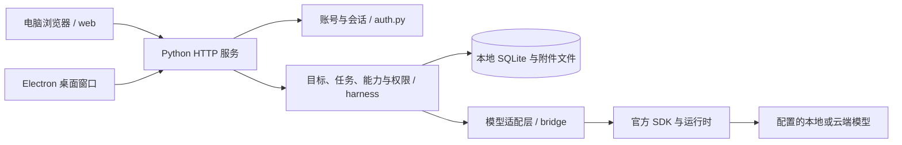

# 架构说明

小辣椒的业务后台是单进程、本机运行的多账号服务，界面采用网页技术。源码另包含 Electron 桌面外壳与 PyInstaller 后台打包流程；本次已提供并验证 Windows x64 安装包。中文与英文源码包拥有相同的业务结构，但各自安装、保存账号与数据；没有跨包同步服务。

## 组件与数据流

| 路径 | 职责 |
| --- | --- |
| `web/` | 原生 HTML、CSS、JavaScript；协作、能力、知识、模型设置与使用引导 |
| `desktop/`、`Build-Desktop.ps1` | Electron 外壳、后台封装与 Windows x64 NSIS 构建流程 |
| `server.py` | 同源 HTTP API、认证检查、静态资源和附件流式读取 |
| `auth.py` | 本地注册、登录、角色绑定与会话 |
| `harness/engine.py` | 工作流依赖、任务状态、预算、分派与执行权限检查 |
| `harness/workboard.py` | 阶段成果、暂存附件、发布范围与交接记录 |
| `harness/runtime.py` | 为主工作空间注入实际模型适配器，显式报告不可用状态 |
| `deepseek-harness-base/bridge/` | 官方 SDK 调用、连接配置与受限运行时适配 |
| `examples/` | 工作流与 Skill 格式模板；不是业务事实 |
| `tests/`、`scripts/` | 隔离回归、HTTP 与运行时验证 |
| `data/workspace/` | 启动后产生的私有工作数据，必须排除在源码分发之外 |

网页前端不需要构建步骤。源码运行依赖由 `Install.ps1` 安装到包内独立虚拟环境；桌面构建通过 `Build-Desktop.ps1` 使用 Python 3.11+ 与 Node.js 22.12+。桌面安装版自带运行文件，终端用户不需要另装这些开发环境。

## 状态、可见性与并发

`/api/coordination` 提供组织公开目标、任务、成员目录、进展、已发布成果和交接摘要。`/api/state` 提供当前账号获准查看的完整工作数据。公开状态与私人正文分开，不能通过“能看到任务”推断“能读取全部资料”。

客户端约每 2 秒同步一次公开状态。组织状态有 revision，任务与交接另有版本；写操作携带预期版本，冲突时返回 409 并要求核对后重试。前端保留草稿，断线时暂停提交。模型可用性独立于业务 revision 更新，避免更改模型配置污染任务历史。

分派与执行资格分离：完整候选目录可以包含未核验、未授权或停用的成员，但接取、开工、提交和 Agent 执行仍经过服务端检查。客户端禁用按钮只改善体验，不是权限边界。

## 身份与存储

首个注册账号成为管理员，后续账号为普通成员；客户端提交角色字段不能自行提权。账号绑定到人类执行者身份，Agent 不使用员工密码登录。

账号数据库与工作数据库位于同一私有数据目录。密码使用 PBKDF2-HMAC-SHA256 和独立随机盐；持久会话令牌只存哈希。Cookie 为 HttpOnly，服务限制本机 Host 与请求 Origin。当前监听地址为 `127.0.0.1`，不应把它解释为已具备公网部署防护。

附件先暂存为上传者可见，显式发布后才组织可见；视频支持按范围读取。知识文档和原始交付继续执行各自权限，不因组织看板可见而自动公开。

## 模型与 Skill 边界

底座锁定 `deepseek-harness-sdk==0.2.2rc2` 与 `deepseek-harness-runtime-bin==0.2.2rc2`。桥接层实际调用 SDK，使用配置的兼容模型协议；产品不要求模型必须来自同一供应商。

未配置或不可用时，执行返回明确失败。只有显式选择规则模式的开发验证才产生带来源标记的规则结果。连接测试的固定文本与真实任务资料分开；Windows 保存的模型密钥使用系统保护机制，界面不回显密钥。

Skill 是能力规格与来源记录。输入、输出、验收、步骤、边界、工具声明和例子参与描述与文本任务上下文，但上传不会自动执行脚本或安装工具。当前桥接限制文件系统、终端、子进程和外部工具能力；新增真实业务动作需要独立设计集成、权限与验证。

## 当前部署边界

- 单个本机服务支持多账号，不是跨网络的托管协作服务。
- Windows x64 桌面封装与安装包已提供。自动更新、HTTPS 部署、SSO、邮箱集成和外部业务连接器尚未作为产品功能交付。
- 工作数据持久化在主机；配置云端模型时，会发送所需的任务资料。源码包不包含账号、会话、凭据、上传资料、模型下载或既有业务记录。
- 测试覆盖的是具体工作流与边界，不代表完成生产环境部署或安全认证。

扩展方向见 [ROADMAP](../ROADMAP.md)，授权以 [LICENSE](../LICENSE) 和 [LICENSING.md](../LICENSING.md) 为准。
